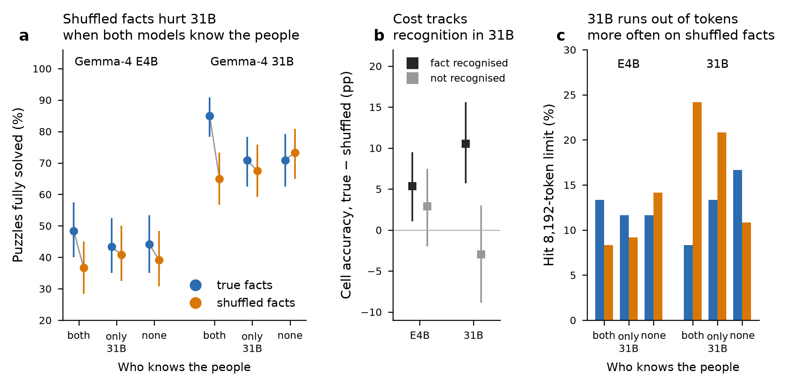

# Knowledge conflict in closed-world deduction: ZebraLogic with real people

Framework and experiments for testing how resilient the reasoning of **small language models (SLMs)** is, compared with larger LLMs, when a standard logic-grid benchmark (ZebraLogic, grid mode) is perturbed with values that can pull the model towards wrong reasoning.

It is part of a PhD thesis on the hypothesis that *SLMs with strong linguistic competence can approach much larger models when external tools and targeted training address their specific weaknesses* (see [docs/project_idea.md](docs/project_idea.md)).

The current focus is **parametric-knowledge conflict**. Puzzles are rebuilt around real Wikidata people. Each puzzle is solved twice: once with the people's **true** facts as the gold solution, and once with the facts **shuffled** across people. Clues and logic are identical. Results are conditioned on a per-model knowledge probe.

## Main result so far (v3, Gemma-4 E4B vs 31B)

From [docs/reports/persons_v3_report.md](docs/reports/persons_v3_report.md); 120 templates × 3 knowledge pools × 2 conditions = 720 puzzles per model, greedy decoding, 8,192-token cap.

| Model | Pool | True facts | Shuffled | Gap (pp) | Holm p |
|---|---|---|---|---|---|
| gemma-4-31B-it | both know | 85.0% | 65.0% | 20.0 | <0.001 |
| gemma-4-31B-it | neither knows | 70.8% | 73.3% | −2.5 | 1.0 |
| gemma-4-E4B-it | both know | 48.3% | 36.7% | 11.7 | 0.060 |
| gemma-4-E4B-it | neither knows | 44.2% | 39.2% | 5.0 | 0.86 |

- **31B:** diff-in-diff (both − none) 22.5 pp [10.8, 35.0]; recognition-conditioned cell gap 13.5 pp [7.1, 19.8].
- **E4B:** diff-in-diff 6.7 pp, p = 0.36, so its drop is not knowledge-specific.
- **Interpretation:** the larger model is the one hurt by knowledge conflict, and part of the conflict cost shows up as longer search that hits the token budget.



## Repository layout

```
src/                 all scripts (flat: they import each other by module name)
data/source/         ZebraLogic grid file, Wikidata relation catalog + frozen KG snapshot, seed lists
data/persons/        Wikidata person candidates, knowledge probes, knowledge-stratified pools
data/puzzles/        generated puzzle variants (parquet) and their validation tables
results/NN_*/        analysis tables and figures, one folder per experiment
docs/reports/        experiment write-ups (results, conclusions, limitations, next steps)
docs/pipeline/       per-stage READMEs written when each stage was built
docs/                literature review / novelty map (+ refs.csv), original project idea
```

Large raw model generations are **not** in the repo; see [data/README.md](data/README.md).

## Pipeline and experiments

1. **Template extraction and perturbation generator.**
   - Code: `zebra_perturb.py` (parser → `Template`, CSP solver, renderer, seeded operators) and `generate_variants.py`.
   - Docs: [PERTURB_README](docs/pipeline/PERTURB_README.md).
   - Every emitted variant is re-parsed and solved, so it has a unique solution, or the intended 0 or 2+ solutions for unsolvable variants.
2. **Wikidata-grounded entities.**
   - Code: `wikidata_kg.py` and `generate_wd_variants.py`.
   - Inputs: the relation catalog `data/source/wikidata_relations.json` and a frozen snapshot, `wikidata_kg_snapshot.json`, for offline, reproducible runs.
   - Docs: [WIKIDATA_README](docs/pipeline/WIKIDATA_README.md).
3. **Pilot evaluation of E4B on bias perturbations.**
   - Code: `run_eval.py` and `analyze_pilot.py`.
   - Results: `results/01_pilot_e4b/`.
4. **Real-person puzzles, E4B.**
   - Code: `unique_persons.py`, `persons_variants.py`, `knowledge_probe.py` and `analyze_persons.py`.
   - Report: [persons_experiment_report](docs/reports/persons_experiment_report.md).
5. **E4B vs 31B.**
   - Code: `compare_models.py`.
   - Report: [persons_two_models_report](docs/reports/persons_two_models_report.md).
6. **Knowledge-stratified pools (v1/v2).**
   - Code: `probe_pool.py`, `build_pools.py`, `pool_variants.py` and `pool_variants_v2.py`.
   - Docs: [POOLS_README](docs/pipeline/POOLS_README.md), [POOL_VARIANTS_README](docs/pipeline/POOL_VARIANTS_README.md) and [POOL_VARIANTS_V2_README](docs/pipeline/POOL_VARIANTS_V2_README.md).
7. **v3, the model-agnostic setup.**
   - Population: a fame-stratified QLever population ([CANDIDATES_README](docs/pipeline/CANDIDATES_README.md)).
   - Knowledge probe: `mcqa_probe.py`, an MCQA probe in "brief" answer mode ([MCQA_PILOT](docs/reports/MCQA_PILOT.md)).
   - Pools: `build_pools_v3.py` ([POOLS_V3_README](docs/pipeline/POOLS_V3_README.md)).
   - Variants: `pool_variants_v3.py` ([VARIANTS_V3_README](docs/pipeline/VARIANTS_V3_README.md)).
   - Analysis: `analyze_v3.py`.
   - Report: [persons_v3_report](docs/reports/persons_v3_report.md).

Literature context and novelty map: [docs/literature_review_zebralogic_novelty.md](docs/literature_review_zebralogic_novelty.md).

## Setup

```bash
conda env create -f environment.yml      # or: pip install -r requirements.txt
conda activate zebralogic
```

Model calls go to an OpenAI-compatible `/v1/chat/completions` endpoint (vLLM).

- The key is read from `VLLM_API_KEY`.
- `VLLM_URL` overrides the default endpoint in `run_eval.py` and `knowledge_probe.py`.
- The v3 scripts read the endpoint, models and workers from [src/config.json](src/config.json).
- The default endpoint is the lab's vLLM server, which needs the university VPN.

Run the scripts from `src/` and pass data paths as arguments, for example:

```bash
cd src
python generate_variants.py ../data/source/zebra_grid.parquet ../out
python mcqa_probe.py config.json ../data/persons/candidates_v3.csv ../out/probe
python build_pools_v3.py ../data/persons/candidates_v3.csv ../out/probe gemma-4-E4B-it gemma-4-31B-it gemma4 ../out/pools
python pool_variants_v3.py ../data/source/zebra_grid.parquet ../data/persons/candidates_v3.csv ../data/persons/pools_v3_gemma4.csv ../out/variants
```

`run_eval.run` appends to a JSONL file and skips uids that are already present, so interrupted runs resume. Records with `finish == "error"` are skipped too: remove them from the JSONL before retrying.

Some scripts still use the flat file names of the workspace they were written in (e.g. `analyze_v3.py`, `compare_models.py`). Copy or symlink the needed files into the working directory, or edit the path constants at the top of the script.

`scripts/recovered/` holds code for steps that were run interactively and never saved as standalone scripts: the QLever candidate fetch, the extra-fact and birth-date probes, the in-puzzle MCQA, the v3 eval loop and the figures. It was recovered from notebook-cell lineage and is kept for provenance. It is not packaged as a CLI.

## Data sources

- **ZebraLogic:** Hugging Face `WildEval/ZebraLogic`, `grid_mode/test-00000-of-00001.parquet` (1,000 puzzles with gold tables). The 4×4, 5×4 and 6×4 sizes are used (4×5 in earlier versions).
- **Wikidata:** queried via WDQS and QLever (`https://qlever.dev/api/wikidata`). Person facts: P19 birthplace, P106 occupation, P569 birth date; earlier versions also used P25, P69 and P2048.

## Status

Research code under active development; not yet published. Private repository.
