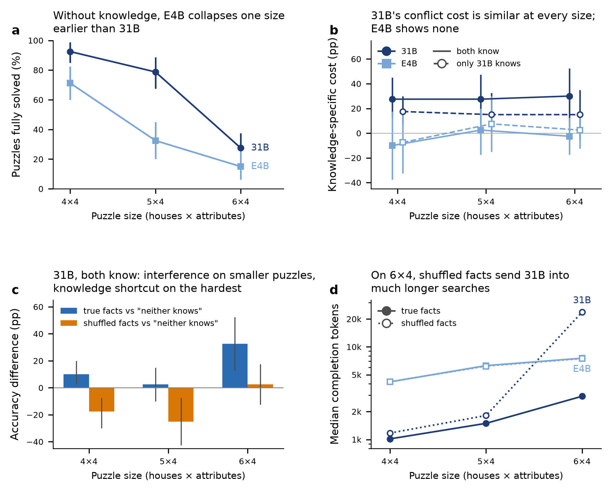

# Effect of puzzle difficulty (4×4 / 5×4 / 6×4)

This is a companion to the main knowledge-conflict report ([report.md](report.md)), using the same 32,768-token run.

**Setup**
- **Sizes:** written houses × attributes in ZebraLogic notation, so 4×4, 5×4 and 6×4 have 4, 5 and 6 houses with 4 attributes each.
- **Templates:** each size has 40 templates, the same 40 in every pool.
- **Unit:** one puzzle = one template × pool × condition.
- **Script:** [analyze_difficulty.py](../src/analyze_difficulty.py). All CIs are 95% template bootstraps (10,000 resamples).

*(a) Accuracy in the "neither knows" pool, averaged over the two conditions (n = 40 templates per point). (b) Knowledge-specific conflict cost: the true − shuffled gap in a pool minus the same gap in "neither knows". (c) 31B in "both know": true facts vs "neither knows" (facilitation) and shuffled facts vs "neither knows" (interference). (d) Median completion tokens.*

## 1. Difficulty and the small-vs-large gap, without knowledge
Data: [diff_knowledge_free_curve.csv](../results/difficulty/diff_knowledge_free_curve.csv) and [diff_model_gap.csv](../results/difficulty/diff_model_gap.csv).

| Size | 31B [95% CI] | E4B [95% CI] | 31B − E4B (pp) | E4B / 31B |
|---|---|---|---|---|
| 4×4 | 92.5% [85.0, 98.8] | 71.2% [60.0, 82.5] | 21.3 | 0.77 |
| 5×4 | 78.8% [67.5, 88.8] | 32.5% [20.0, 45.0] | 46.3 | 0.41 |
| 6×4 | 27.5% [17.5, 37.5] | 15.0% [6.2, 26.2] | 12.5 | 0.55 |

- **E4B collapses between 4 and 5 houses; 31B between 5 and 6.** The absolute gap between the models is largest at 5×4. At 6×4 it shrinks only because both models approach the floor.
- **E4B's reasoning grows with size,** from a median of about 4.2k tokens at 4×4 to 6.2k at 5×4 and 7.5k at 6×4, and it never reaches the 32k budget. So E4B's losses on large puzzles are reasoning failures, not truncation.
- **The SLM gap is a closed-world search gap,** and it widens as search depth increases.

## 2. Does the knowledge-conflict effect depend on difficulty?
Data: [diff_gaps.csv](../results/difficulty/diff_gaps.csv) and [diff_trend.csv](../results/difficulty/diff_trend.csv).

**Knowledge-specific cost (diff-in-diff vs "neither knows", pp [95% CI]):**

| Model | Pool | 4×4 | 5×4 | 6×4 |
|---|---|---|---|---|
| 31B | both know | **27.5 [12.5, 45.0]** | **27.5 [7.5, 47.5]** | **30.0 [5.0, 52.5]** |
| 31B | only 31B knows | **17.5 [7.5, 30.0]** | 15.0 [−0.1, 32.5] | 15.0 [−5.0, 35.0] |
| E4B | both know | −10.0 [−37.5, 17.5] | 2.5 [−17.5, 20.0] | −2.5 [−17.5, 12.6] |
| E4B | only 31B knows | −7.5 [−32.5, 15.0] | 7.5 [−15.0, 30.0] | 2.5 [−12.5, 17.5] |

**Recognition-conditioned cell gap** (recognised minus unrecognised facts; [diff_recognition.csv](../results/difficulty/diff_recognition.csv)):
- **31B:** 13.8 pp [6.3, 23.2], 16.0 pp [7.1, 26.4] and 14.0 pp [3.2, 26.2] at 4×4, 5×4 and 6×4.
- **E4B:** 0.3, 2.1 and −1.5 pp, none significant.

**What this shows:**
1. **31B's knowledge-specific cost is about the same at every size** (27.5 → 30 pp for "both know"; 6×4 − 4×4 = +2.5 pp [−27.5, 32.5], p = 0.9). The recognition-conditioned contrast is also flat at about 14–16 pp.
2. **The raw true − shuffled gap does grow with size** (17.5 → 25 → 30 pp), and so does the cell-level gap (14.6 → 21.5 → 31.5 pp; trend +16.9 pp, p = 0.1). Most of that growth is mirrored by the unknown-people baseline (−10 → −2.5 → 0 pp). At 4×4 the diff-in-diff is inflated by that baseline: four 4×4 templates were solved only with shuffled facts, none only with true facts.
3. **E4B shows no knowledge-specific cost at any size.** Floor accuracy at 6×4 (10–15% per cell) limits puzzle-level power, but the cell-level recognition contrast, which is less affected by the floor, is null as well.

## 3. What the effect consists of changes with difficulty
Data: facilitation and interference for 31B in "both know":

| Size | True facts vs "neither knows" | Shuffled facts vs "neither knows" | True / shuffled / neither (avg) |
|---|---|---|---|
| 4×4 | +10.0 [2.5, 20.0] | **−17.5 [−30.0, −7.5]** | 97.5 / 80.0 / 92.5% |
| 5×4 | +2.5 [−10.0, 15.0] | **−25.0 [−42.5, −7.5]** | 80.0 / 55.0 / 78.8% |
| 6×4 | **+32.5 [12.5, 52.5]** | +2.5 [−12.5, 17.5] | 60.0 / 30.0 / 27.5% |

- **4×4 and 5×4:** 31B can solve these by deduction (79–93% with unknown people). True facts add little. Shuffled facts *interfere*, pulling accuracy well below the no-knowledge baseline.
- **6×4:** deduction mostly fails (27.5% with unknown people). True facts about famous people raise accuracy to 60%, so knowledge acts as a *shortcut* that substitutes for search. Shuffled facts leave 31B at about the no-knowledge level (30% vs 27.5%).
- **Trend tests (6×4 − 4×4):** facilitation +22.5 pp [0, 45], interference +20 pp [0, 40], both p ≈ 0.1. The direction is consistent, but per-size estimates rest on 40 templates.
- **Caveat:** this is a cross-pool comparison. The "both know" and "neither knows" pools use the same templates but different people and value vocabularies, so part of the 6×4 facilitation could reflect familiar values being easier to track. The within-pool true-vs-shuffled gap is unaffected by this.
- **Effect on the model gap:** with true facts about famous people at 6×4, 31B leads E4B by 50 pp (60% vs 10%); with unknown people the lead is 12.5 pp. On the hardest puzzles, part of 31B's advantage is world knowledge rather than deduction.

## 4. Search length and truncation
Data: [diff_tokens.csv](../results/difficulty/diff_tokens.csv) and [diff_sensitivity_no_truncation.csv](../results/difficulty/diff_sensitivity_no_truncation.csv).

| 31B | 4×4 | 5×4 | 6×4 |
|---|---|---|---|
| Median tokens, true → shuffled | 1,016 → 1,174 | 1,494 → 1,816 | **2,930 → 23,696** |
| Truncated at 32k, true / shuffled (of 120) | 7 / 10 | 13 / 24 | 36 / 57 |

- **On 6×4, shuffled facts change how 31B works:** most of its shuffled-fact answers become runaway guess-and-check searches. E4B's token use depends on size but not on condition.
- **Dropping templates truncated in either condition** (31B, "both know") leaves gaps of:
  - 4×4: 5.9 pp (n = 34, 2 / 0 discordant, p = 0.5);
  - 5×4: 21.4 pp (n = 28, 6 / 0, p = 0.03);
  - 6×4: 22.2 pp (n = 18, 5 / 1, p = 0.22).
- So at 4×4 the effect runs mostly through runaway search. At 5×4 it is a genuine wrong-answer effect.

## Conclusions
1. **Difficulty drives most of the accuracy loss for both models.** The small-vs-large gap is largest at 5 houses, where E4B has already collapsed and 31B has not. This is the regime where tools (e.g. a constraint solver) or training for deeper search would help an SLM most.
2. **The knowledge-conflict cost is a large-model phenomenon of roughly constant size.** 31B's knowledge-specific cost is about 28–30 pp at every size for well-known people, and its recognition contrast is about 14–16 pp at every size. E4B shows none at any size.
3. **What the cost consists of changes with difficulty:**
   - 4×4: interference that works mainly through runaway search;
   - 5×4: genuine interference (wrong answers);
   - 6×4: loss of a knowledge shortcut, together with very long searches.

## Limitations
- **n = 40 templates per size and pool,** so per-size CIs are wide. Trend contrasts are at p ≈ 0.1.
- **Floor effects at 6×4,** especially for E4B (10–15% per cell).
- **Size is confounded with template identity.** The 4×4, 5×4 and 6×4 templates are different puzzles, not the same puzzle with more houses, so clue types and counts also vary by size.
- **A single run,** and decoding on this endpoint is not exactly reproducible (see the main report).
