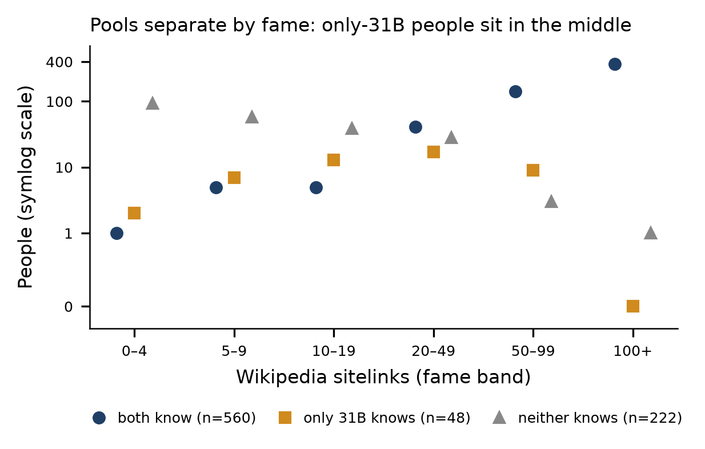

# Knowledge pools (gemma-4 E4B vs 31B, MCQA probe)

Built by [`src/build_pools.py`](../../src/build_pools.py) from `candidates_v3.csv` (4,515 people) and the brief-recall multiple-choice probe ([probe.md](probe.md); `runs/probe_mcqa_<model>.jsonl`; 3 facts per person: birthplace, occupation, birth year; 4 options; refusals count as wrong).

## Definitions (strict rule)
- A model **knows** a person if it answers **all 3** facts correctly, and **does not know** them if it answers **none** correctly.
- **only_large** (only 31B knows): 31B knows, E4B doesn't → **48 people**.
- **both**: both models know → **560 people**.
- **none**: neither model gets any fact right → **222 people**.

## Why strict
With one 4-option question per fact, a model that knows nothing about a person still gets each fact right 25% of the time. An estimated 526 people are unknown to 31B and get 0 of 3 from E4B. Among them, the looser rule (≥ 2 of 3, one of them birthplace or birth year) would have labelled about 82 as known to 31B by luck: about a third of the 244-person only_large pool under that rule, so ~66% genuine. All 3 correct happens by luck 1.6% of the time, so about 8 of the 48 (~83% genuine). The figures assume uniform guessing and are approximate. Chance labels are negligible in `both` (both models would have to be lucky on all 3 facts) and in `none`. The looser-rule columns (`pool`, `known_*`) are kept in the CSV for reference.

## Fame
The pools differ strongly in fame (median sitelinks: both 112.5, only_large 20.0, none 5.5): famous people are known to both models, mid-fame people only to 31B, and obscure people to neither. A fame-matched subset (`matched_final`: equal counts per sitelinks band across the three pools) has only 31 people per pool, so the analysis should compare true vs shuffled facts **within** each pool rather than accuracy across pools.

| Band | both | only_large | none |
|---|---|---|---|
| a_0-4 | 1 | 2 | 93 |
| b_5-9 | 5 | 7 | 58 |
| c_10-19 | 5 | 13 | 39 |
| d_20-49 | 41 | 17 | 28 |
| e_50-99 | 142 | 9 | 3 |
| f_100+ | 366 | 0 | 1 |

## Files
- `data/pools_v3_gemma4.csv`: all 4,515 candidates. Columns: per model (`_small` = E4B, `_large` = 31B) `knows_<fact>`, `k`, `known`, `known_strict`, `unknown`; `pool_final` (strict, used downstream), `pool` (looser rule), `pool_strict`, `matched_final`.
- `results/pools_v3_summary.csv`, `results/pools_v3_by_band.csv`, `results/pools_v3_by_fame.png`.
- For another model family, list both models in `src/config.json`, run `python run_experiment.py probe`, then `python build_pools.py ../data/candidates_v3.csv ../runs <small_model> <large_model> <family> ../data`.

