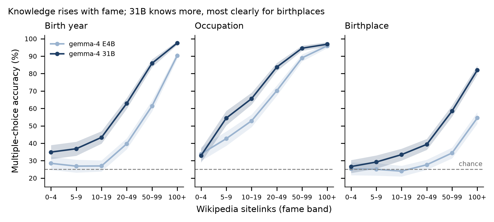

# MCQA knowledge probe

Code: [`src/mcqa_probe.py`](../../src/mcqa_probe.py), run with `python run_experiment.py probe`.

- **Questions:** one 4-option question per person × fact (birthplace, occupation, birth year) for all 4,515 candidates. That is 13,545 questions per model, rebuilt deterministically by `mcqa_probe.build_questions`.
- **Correct option:** the person's displayed value in `candidates_v3.csv`.
- **Distractors:** never true of the person.
  - **Birthplace:** other candidates' birthplaces from the same country, so a name does not give the answer away. A distractor is never equal to, or word-contained in, an accepted name of the true birthplace.
  - **Occupation:** other displayed occupations, sampled by frequency, excluding the person's P106 labels and their aliases.
  - **Birth year:** years within ±25 of the true year, at least 3 years from it and from each other, and not after 2010.
- **Answer position:** exactly balanced over A–D for each fact.
- **Answer format** (`answer_mode: "brief"` in `config.json`): one short recall sentence, then `Answer: X` on the last line, with up to 80 tokens and greedy decoding. Letter-only answers proved unreliable for these models: they underestimated what the models knew and showed strong position bias. Refusals and unparsed answers count as wrong.

## Accuracy (chance = 25%)

| Model | Birth year | Birthplace | Occupation |
|---|---|---|---|
| gemma-4-31B-it | 64.4% | 47.6% | 75.8% |
| gemma-4-E4B-it | 48.7% | 32.9% | 68.3% |

Source: [`results/mcqa_summary.csv`](../../results/mcqa_summary.csv). By fame band: [`results/mcqa_by_band_long.csv`](../../results/mcqa_by_band_long.csv).

The probe defines the knowledge pools ([pools.md](pools.md)).
