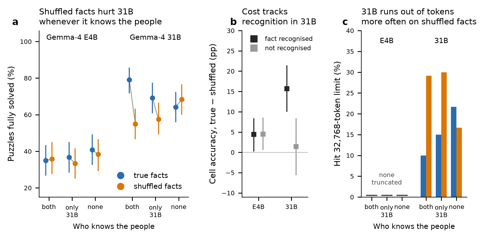

# Knowledge conflict in ZebraLogic: Gemma-4 E4B vs 31B

## Question
When a ZebraLogic puzzle uses real people's attributes, does the model's own world knowledge interfere with closed-world deduction, and does this depend on model size? Each puzzle is solved twice: once where the gold solution matches the real facts (**true facts**), and once where every attribute is reassigned to a different person (**shuffled facts**). Clues, headers and logic are identical.

## Design
- **Candidates:** 4,515 Wikidata people, stratified by fame ([candidates_v3.csv](../data/candidates_v3.csv)). Attributes are birthplace, occupation and birth year.
- **Knowledge probe:** 4-option MCQA with one recall sentence before the letter ([mcqa_knowledge_vs_fame.png](../results/mcqa_knowledge_vs_fame.png)).
- **Pools, strict rule** (knows = all 3 facts correct; doesn't know = 0 correct; [pools.md](methods/pools.md)):
  - **both know:** 560 people;
  - **only 31B knows:** 48 people;
  - **neither knows:** 222 people.
- **Puzzles:** the same 120 ZebraLogic templates are used in every pool (40 each of 4×4, 5×4, 6×4). That gives 3 pools × 120 × 2 conditions = 720 puzzles per model ([zebralogic_pools_v3.parquet](../data/zebralogic_pools_v3.parquet), [variants.md](methods/variants.md)).
- **Recognition flag:** an in-puzzle MCQA, whose options are the puzzle's own values, marks each fact as *recognised* or not by each model ([inpuzzle_mcqa_summary.csv](../results/inpuzzle_mcqa_summary.csv)).
- **Inference:**
  - temperature 0, a **32,768-token** output budget, so models can produce long reasoning chains; the server accepts this even with the longest prompt (about 1,330 tokens);
  - SSE streaming, prompt building and scoring in [evaluate.py](../src/evaluate.py), run by [run_experiment.py](../src/run_experiment.py);
  - all 720/720 puzzles completed for each model ([E4B outputs](../data/README.md#raw-model-outputs), [31B outputs](../data/README.md#raw-model-outputs));
  - an answer that hits the budget counts as wrong.
- **Statistics** ([analyze.py](../src/analyze.py)):
  - true vs shuffled within each pool: McNemar test, Holm-corrected within each model;
  - cell-level gaps: template-cluster bootstrap;
  - pool contrasts (diff-in-diff) and facilitation/interference: bootstrap over templates.

### Infrastructure notes
- **Use streaming for long generations.** The endpoint drops non-streaming requests that run longer than about 300 s (`RemoteDisconnected`). Streaming avoids this (tested 366 s / 13.9k tokens).
- **Outputs at temperature 0 are not exactly reproducible on this endpoint.** Repeating one prompt gives a first completion that diverges from all later ones at a fixed position, which points to the vLLM prefix cache and batching. True and shuffled variants are always evaluated in the same run, so this noise affects both conditions equally.

## Results

*(a) Puzzle accuracy with 95% bootstrap CIs; n = 120 templates per point. (b) Cell-accuracy gap (true − shuffled), split by whether the model recognised the fact in the in-puzzle MCQA. (c) Share of answers that hit the 32,768-token limit; E4B never did.*

### 1. Puzzle accuracy ([v3_summary.csv](../results/v3_summary.csv), [v3_tests.csv](../results/v3_tests.csv))

| Model | Pool | True facts | Shuffled | Gap (pp) | Discordant (true-only / shuffled-only) | Holm p | Cell gap pp [95% CI] |
|---|---|---|---|---|---|---|---|
| 31B | both know | 79.2% | 55.0% | **24.2** | 33 / 4 | <0.001 | **23.3 [15.2, 31.5]** |
| 31B | only 31B knows | 69.2% | 57.5% | **11.7** | 19 / 5 | 0.013 | **10.8 [4.0, 17.9]** |
| 31B | neither knows | 64.2% | 68.3% | −4.2 | 10 / 15 | 0.42 | −3.2 [−10.7, 4.3] |
| E4B | both know | 35.0% | 35.8% | −0.8 | 18 / 19 | 1.0 | −1.6 [−7.7, 4.4] |
| E4B | only 31B knows | 36.7% | 33.3% | 3.3 | 18 / 14 | 1.0 | 2.1 [−4.3, 8.4] |
| E4B | neither knows | 40.8% | 38.3% | 2.5 | 14 / 11 | 1.0 | 4.0 [−1.6, 9.9] |

The breakdown by puzzle size is in [v3_by_size.csv](../results/v3_by_size.csv) and is analysed in [difficulty.md](difficulty.md).

### 2. Is the cost specific to knowledge? ([v3_diff_in_diff.csv](../results/v3_diff_in_diff.csv), [v3_knowledge_gap.csv](../results/v3_knowledge_gap.csv), [v3_knowledge_gap_by_pool.csv](../results/v3_knowledge_gap_by_pool.csv))

**Diff-in-diff:** the gap in a pool minus the gap in "neither knows", over the same templates.

| Model | Contrast | Diff-in-diff (pp) [95% CI] | p |
|---|---|---|---|
| 31B | both − none | **28.3 [16.7, 40.8]** | <0.001 |
| 31B | only 31B − none | **15.8 [5.0, 26.7]** | 0.007 |
| E4B | both − none | −3.3 [−16.7, 9.2] | 0.65 |
| E4B | only 31B − none | 0.8 [−11.7, 13.3] | 0.94 |

**Cells split by recognition, all pools pooled:**
- **31B:** gap 15.7 pp [10.0, 21.5] on recognised facts vs 1.4 pp [−5.6, 8.4] on unrecognised ones. Difference 14.2 pp [8.1, 20.6], bootstrap p = 0.000.
- **E4B:** 4.4 pp vs 4.5 pp. Difference −0.1 pp [−4.3, 3.9], p = 0.96.

**Within pools (31B):**
- "both know": gap on recognised cells 23.3 pp [14.0, 31.5].
- "only 31B knows": 15.0 pp [6.7, 22.3] on recognised cells, and also 15.1 pp [4.2, 26.4] on its 291 unrecognised cells. Within a person 31B knows, the conflict cost spreads to that person's other facts.

### 3. Facilitation vs interference ([v3_facilitation_interference.csv](../results/v3_facilitation_interference.csv))
Each condition in a knowledge pool is compared with the same condition in "neither knows", template by template:

| Model | Pool | True facts vs none (facilitation) | Shuffled vs none (interference) |
|---|---|---|---|
| 31B | both know | **+15.0 pp [6.7, 24.2], p = 0.001** | **−13.3 pp [−22.5, −4.2], p = 0.005** |
| 31B | only 31B knows | +5.0 [−3.3, 13.3], p = 0.28 | **−10.8 [−17.5, −5.0], p < 0.001** |
| E4B | both know | −5.8 [−14.2, 2.5], p = 0.19 | −2.5 [−11.7, 6.7], p = 0.66 |
| E4B | only 31B knows | −4.2 [−14.2, 5.8], p = 0.45 | −5.0 [−13.3, 3.3], p = 0.29 |

### 4. Truncation and search length ([v3_sensitivity_no_truncation.csv](../results/v3_sensitivity_no_truncation.csv))
- **E4B never reached the limit** (longest answer 11,900 tokens). Its median length is about 5,900–6,300 tokens in every cell.
- **31B hit the 32k limit on 147 of 720 puzzles.** These are runaway guess-and-check enumerations ("Let's try: House 1 … No. 537."), mostly not repetition loops: the model keeps searching instead of committing.
- **31B's truncation depends on the facts:**
  - "both know": 10.0% (true) → 29.2% (shuffled);
  - "only 31B knows": 15.0% → 30.0%;
  - "neither knows": 21.7% → 16.7%.
- **Median tokens follow the same pattern:** 1,280 → 2,535 for "both know", against 1,700 → 1,479 for "neither knows".
- **Sensitivity check:** dropping every template truncated in either condition (conservative, because it selects on outcome) leaves:
  - 31B "both know": 93.8% → 78.8% (−15.0 pp, 13 / 1 discordant, n = 80, p = 0.002);
  - 31B "only 31B knows": −5.3 pp (n = 76, p = 0.29);
  - 31B "neither knows": −1.2 pp.

## Conclusions
1. **The larger model is hurt by knowledge conflict, and the cost follows its knowledge.** 31B loses 24 pp when facts about people it knows well are shuffled, 12 pp for mid-fame people only it knows, and nothing for unknown people. The diff-in-diff estimates (28.3 and 15.8 pp) and the recognition-conditioned gap (14.2 pp) are all clearly non-zero. Even quiz-level recognition of mid-fame people is enough to cause interference.
2. **The SLM shows no knowledge-specific cost.** E4B's true–shuffled gaps are within ±4 pp in every pool, and its recognition-conditioned difference is −0.1 pp. Its MCQA scores show it knows many of these facts, yet the knowledge does not seem to enter its puzzle solving.
3. **31B's gap combines facilitation and interference.** With true facts about famous people, 31B solves 15 pp more puzzles than on the same templates with unknown people. With shuffled facts it solves 13 pp fewer. For mid-fame people only the interference part is clear (−10.8 pp).
4. **The mechanism shows up as longer, unresolved search.** Conflicting facts double 31B's median reasoning length and triple the rate at which it exhausts a 32k budget. More budget does not help, because the model keeps enumerating instead of trusting the clues.

## Limitations
- **Fame and value confound across pools.** Pools differ in fame and in their value vocabularies. Within-pool comparisons are clean; the cross-pool facilitation estimate could partly reflect familiar values being easier to track.
- **A single run, and decoding is not exactly reproducible.** Effects of about 10 pp in a single pool (e.g. "only 31B knows") should be confirmed with replicate runs.
- **The "only 31B knows" pool is small:** 48 people, one reused up to 31 times, and a single draw (d0).
- **One model family.**
- **31B still truncates 20% of answers at 32k.** These are scored as failures, which is part of the effect rather than an artefact.
- **The recognition flag is imperfect.** It comes from in-puzzle MCQA, and birthplace is partly guessable from names.

## Next steps
1. **Replicate:** 2–3 more 32k runs, or sampling at T = 0.6 with several seeds, then pool them to estimate run-level variance.
2. **Mine the reasoning traces.** Check whether 31B invokes real facts or second-guesses clues in shuffled puzzles, especially in the truncated enumerations.
3. **Add model families** (Qwen3.5-9B / Qwen3.8-27B, Llama-3.1-8B, Salamandra-7B), each with its own probe and pools.
4. **Test mitigations:** a closed-world instruction, a constraint-solver tool, or RLVR rewarding clue-only justification. Check whether they remove 31B's interference and runaway search without removing its facilitation.
