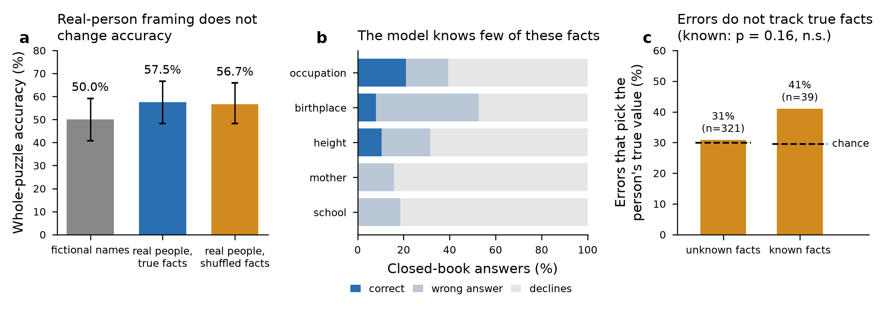

# Real-person ZebraLogic variants: does world knowledge bias SLM logical reasoning?

**Model:** `gemma-4-E4B-it` (nodo08 vLLM endpoint) · **Date:** 2026-10-19 · **Puzzles:** 120 ZebraLogic grid puzzles (4×4, 4×5, 5×4; 40 each) × 3 conditions = 360 prompts

---

## 1. Question

ZebraLogic puzzles are closed-world: the clues alone determine the answer. If the entities are *real people* and the attribute values are *real facts about them*, a model may answer from what it knows instead of reasoning from the clues. We test two hypotheses:

- **H1 (shortcut):** when the gold solution agrees with world knowledge, accuracy goes up.
- **H2 (interference):** when the gold solution contradicts world knowledge, accuracy goes down, and errors drift toward the person's true value.

This is part of the reasoning-resilience framework. Its goal is to find weaknesses specific to SLMs, which can then be targeted with training or tool use.

## 2. Data

### 2.1 Person pool
[unique_persons.csv](../../data/persons/unique_persons.csv) was produced by [unique_persons.py](../../src/unique_persons.py):

- The script queries QLever's Wikidata endpoint for humans with exactly one value each for place of birth (P19), occupation (P106), mother (P25), educated at (P69) and height (P2048).
- An exact MILP then picks the largest set of people in which **no two people share any value in any column**. Ties are broken toward people with more sitelinks.
- The result is 39 people. Because every value is unique, a value identifies its owner without ambiguity, which is what a ZebraLogic attribute needs.

### 2.2 Templates
We used the 120 original puzzles of sizes 4×4, 4×5 and 5×4 from WildEval/ZebraLogic `grid_mode`. They were parsed into logical templates with the existing `zebra_perturb.py` parser: attributes, value slots, the 9 clue relation types and the gold grid.

## 3. Method

### 3.1 Variant construction ([persons_variants.py](../../src/persons_variants.py))
For each puzzle, every non-Name attribute (3 or 4 of them) is **retyped** to one of the five person relations. Relations are drawn per puzzle with a seed derived from the puzzle id. Each relation has a fixed header line and clue phrase:

| Relation | Header line | Clue phrase |
|---|---|---|
| place of birth | Each person was born in a different place | the person who was born in {v} |
| occupation | Each person has a different occupation | the person who works as a {v} |
| mother | Each person has a different mother | the person whose mother is {v} |
| educated at | Each person studied at a different institution | the person who studied at {v} |
| height | Each person has a different height in cm | the person who is {v} cm tall |

Relation usage over the 120 puzzles: occupation 93, educated at 82, height 77, mother 75, place of birth 73.

For each puzzle, *n* people (*n* = number of houses) are drawn from the pool. Three conditions are then rendered from the **same logical template**. They have identical clue wording, clue order and value lists in the header, in the same order:

| Condition | Names | Attribute values | Relation to world knowledge |
|---|---|---|---|
| `control` | original fictional names (Alice, Eric, …) | the drawn people's true values | none (fictional names give no link) |
| `aligned` | real people | each person holds **their own** true values | gold = world knowledge |
| `conflict` | real people | each attribute is a **derangement**: no person holds their own value | gold contradicts world knowledge for every cell |

In `conflict`, the derangements are also chosen to minimise *cross-attribute coincidences*, i.e. two values in the same house that belong to the same third person. They are zero in 80 puzzles. In the 40 puzzles of size 4×5 there are 4, because 4 houses × 5 columns makes zero coincidences impossible.

**Guards against ambiguity:**

- No label in a puzzle may be a substring of another (e.g. *Dundee* / *University of Dundee*, *Nancy Swider-Peltz* / *Nancy Swider-Peltz, Jr*). This includes the fictional control names.
- Labels containing " and " or " is ", or ending in ".", are rejected because they break the clue grammar. Examples are *Russian State University of Physical Education, Sport, Youth and Tourism* and *Riccardo Schicchi Jr.*
- In the end, 38 of the 39 people were used. The most frequent appear in 23 puzzles each.

**Validation:** every rendered puzzle text was re-parsed from scratch and solved with the CSP solver. All **360/360** variants have exactly one solution equal to the relabelled gold. Checking the gold grids confirmed that in `aligned` 100% of the cells hold the person's true value, and in `conflict` 0%.

Example (puzzle `lgp-test-4x4-…`, same template; the clue shown is #1):

- *aligned:* names `Jean-Luc Godard, Dougie Hamilton, Andy Murray, Riccardo Schicchi Jr.`; clue 1 "The person who was born in 7th arrondissement of Paris is directly left of the person who studied at St. George's British International School."
- *conflict:* same names and the same header value lists; clue 1 "The person who was born in Toronto is directly left of the person who studied at Crestwood Preparatory College."
- *control:* names `Alice, Eric, Arnold, Peter`, with the aligned values.

(This example was rendered before the trailing-period filter was added, so it still shows *Riccardo Schicchi Jr.*; the evaluated dataset excludes him.)

### 3.2 Evaluation
- **Prompt and scoring:** `run_eval.py` from the pilot, unchanged. The prompt is ZeroEval-style, with one worked 3-house example and a JSON `{reasoning, solution}` answer. Decoding is greedy (temperature 0) with `max_tokens` = 8192. The scorer falls back to the last `"solution"` key for robustness.
- **Execution:** run from the local machine to nodo08 over the UJA VPN with 24 parallel requests. The main pass took 4,128 s. 14 requests failed with `RemoteDisconnected` and were rerun successfully. The final set has 360 responses: 356 ended normally and 4 were cut off at the token limit. 5 responses could not be parsed. Truncated and unparsable answers count as wrong.
- **Statistics** ([analyze_persons.py](../../src/analyze_persons.py)):
  - Whole-puzzle accuracy: exact McNemar test on puzzle pairs, Holm-corrected over 3 contrasts.
  - Cell accuracy: paired bootstrap 95% CI.
  - Response length: sign test on completion tokens.

### 3.3 Closed-book knowledge probe
For each of the 38 people we asked five direct questions, one per relation (190 questions; greedy decoding, short answers). Example: "What is the name of X's mother? Answer with her full name only."

Scoring rules:

- String match, with synonyms accepted for occupations (soccer player ↔ association football player, filmmaker ↔ film director, actress ↔ actor/film actor, general ↔ military officer).
- City-level birthplaces accepted for Paris arrondissements.
- Heights within ±3 cm accepted.
- Two lenient-match false positives were corrected by hand. "María del Carmen Rodríguez Zapatero" is a different person from the gold "María de la Purificación Zapatero". For Nancy Swider-Peltz, Jr, the answer was a refusal that echoed the name.

### 3.4 Knowledge-intrusion analysis (conflict only)
For every wrong cell in `conflict` whose predicted value is a valid value for that attribute, we check whether the prediction equals **the row-person's true Wikidata value**. In `conflict`, that true value is always one of the *n*−1 wrong options, so the chance rate is 1/(*n*−1): 1/3 with 4 houses, 1/4 with 5. The test compares the observed count with the summed chance expectation using a Monte-Carlo Poisson-binomial test (two-sided). The analysis is split by whether the probe showed the model knows that fact.

## 4. Results

*Figure.* (a) Whole-puzzle accuracy per condition (n = 120 puzzles each; bars = 95% bootstrap CI). (b) Closed-book probe of the same 38 people (n = 38 per relation). (c) Share of wrong in-domain cells in `conflict` that contain the person's true value; dashed lines show chance (n = wrong cells).

### 4.1 Accuracy ([persons_summary.csv](../../results/02_persons_e4b/persons_summary.csv))

| Condition | Puzzle acc. [95% CI] | Cell acc. [95% CI] | Truncated | Parse fail | Median completion tokens |
|---|---|---|---|---|---|
| control (fictional names) | 50.0% [40.8, 59.2] | 74.0% [68.3, 79.5] | 1 | 1 | 4,898 |
| aligned (true facts) | 57.5% [48.3, 66.7] | 79.0% [73.8, 84.1] | 1 | 2 | 4,511 |
| conflict (shuffled facts) | 56.7% [48.3, 65.8] | 78.8% [73.5, 84.0] | 2 | 2 | 5,066 |

By size (puzzle accuracy):

| Size | control | aligned | conflict |
|---|---|---|---|
| 4×4 | 57.5% | 65.0% | 70.0% |
| 4×5 | 55.0% | 57.5% | 57.5% |
| 5×4 | 37.5% | 50.0% | 42.5% |

### 4.2 Paired tests ([persons_paired_tests.csv](../../results/02_persons_e4b/persons_paired_tests.csv), [persons_token_tests.csv](../../results/02_persons_e4b/persons_token_tests.csv))

| Contrast | Δ puzzle acc. | Discordant pairs (A only / B only) | McNemar p | Holm p | Δ cell acc. [95% CI] |
|---|---|---|---|---|---|
| aligned − control | +7.5 pp | 27 / 18 | 0.233 | 0.688 | +5.0 pp [−1.5, +11.4] |
| conflict − control | +6.7 pp | 21 / 13 | 0.230 | 0.688 | +4.8 pp [−0.6, +10.4] |
| aligned − conflict | +0.8 pp | 19 / 18 | 1.000 | 1.000 | +0.2 pp [−5.6, +5.9] |

Response length: conflict is a median 162.5 tokens longer than aligned (longer in 68 of 119 pairs, sign test p = 0.14). Control vs aligned: +165 tokens (68/120, p = 0.17). Neither difference is significant.

### 4.3 What the model knows ([knowledge_probe.csv](../../data/persons/knowledge_probe.csv))

| Relation | Correct | Declines to answer |
|---|---|---|
| occupation | 8 / 38 (21%) | 61% |
| height (±3 cm) | 4 / 38 (11%) | 68% |
| place of birth | 3 / 38 (8%) | 47% |
| mother | 0 / 38 (0%) | 84% |
| educated at | 0 / 38 (0%) | 82% |
| **total** | **15 / 190 (7.9%)** | |

The 15 known facts belong to 9 people. Most are occupations of very famous people: Andy Murray, Dirk Nowitzki, Kajol, Marion Cotillard, Jean-Luc Godard, Zapatero. The model gets even well-known facts wrong: for Andy Murray it gives Stirling as his birthplace and "Lynne Murray" as his mother, and for Dirk Nowitzki it gives "Heike Nowitzki" as his mother.

### 4.4 Knowledge intrusion in `conflict` ([persons_intrusion.csv](../../results/02_persons_e4b/persons_intrusion.csv), cell-level data in [persons_conflict_cells.csv](../../results/02_persons_e4b/persons_conflict_cells.csv))

| Subset | Scored cells | Cell acc. | Wrong in-domain cells | Picked the true value | Expected by chance | Observed vs chance rate | p |
|---|---|---|---|---|---|---|---|
| all | 1,678 | 78.5% | 360 | 115 | 107.5 | 31.9% vs 29.9% | 0.41 |
| facts the model does not know | 1,528 | 79.0% | 321 | 99 | 96.0 | 30.8% vs 29.9% | 0.76 |
| facts the model knows | 150 | 74.0% | 39 | 16 | 11.5 | 41.0% vs 29.5% | 0.16 |

## 5. Conclusions

1. **gemma-4-E4B-it's reasoning is not measurably biased by world knowledge in this setting. That is mostly because it has very little relevant knowledge.** The probe shows it knows only 7.9% of the facts and declines most questions. For this SLM, therefore, "aligned vs conflict" mostly contrasts real names with real names, not agreement with conflict against knowledge.

2. **Where the model does know a fact, there is a hint of interference, but it is underpowered.** On the 150 cells whose fact the model knows:
   - Conflict cell accuracy is 74.0%, against 79.0% for unknown facts.
   - Wrong answers pick the true value 41% of the time against 29.5% by chance.

   But this rests on 39 wrong cells (p = 0.16). It is the direction H2 predicts and worth testing with a design that has more known facts, not a finding.

## 6. Limitations

- Only one model, 120 templates.
- The probe uses open-ended questions with heuristic string matching. Partial knowledge (e.g. "Paris" for "7th arrondissement of Paris") was counted as known. A multiple-choice probe over the puzzle's own value set would match the puzzle task more closely.
- In the 40 puzzles of size 4×5, the conflict condition has unavoidable cross-attribute coincidences, where two values in one house belong to the same third person.
- The control keeps the real people's attribute values. Values such as *Judy Murray* as a mother can still evoke associations, even with fictional names.

## 7. Next steps

1. **Larger-model comparison:** run the same 360 prompts on larger models with the same knowledge probe. Measuring the small-vs-large gap here needs a model that actually knows the facts.
2. **Knowledge-matched pool:** Probe each candidate first, ideally with multiple-choice questions over the puzzle's own value set, maximising known facts rather than sitelinks.