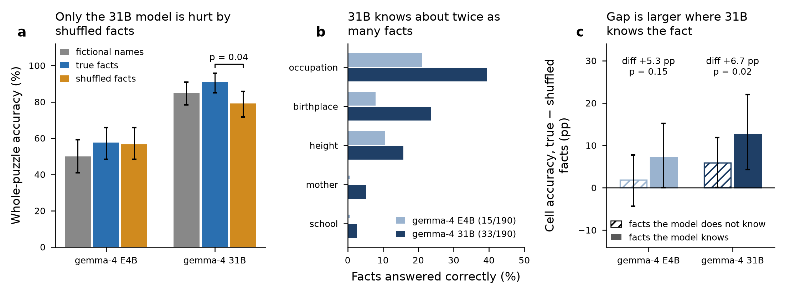

# Real-person ZebraLogic variants: gemma-4-E4B-it vs gemma-4-31B-it

**Date:** 2026-10-23 · **Models:** `gemma-4-E4B-it` (SLM) and `gemma-4-31B-it` (larger model from the same family), both on the nodo08 vLLM endpoint · **Data:** the same 360 prompts (120 ZebraLogic templates × 3 conditions)

This extends the single-model experiment described in [persons_experiment_report.md](persons_experiment_report.md). That report covers the design of the person pool, the variant generator and the validation.

---

## 1. Setup

- **Puzzles:** [zebralogic_persons.parquet](../../data/puzzles/zebralogic_persons.parquet), unchanged. It contains 120 templates (40 each of 4×4, 4×5, 5×4). Every non-Name attribute is retyped to a Wikidata person relation (birthplace, occupation, mother, school, height). Each template has three conditions with identical clue wording:
  - `control`: fictional names with the real people's attribute values.
  - `aligned`: real people holding their own true facts.
  - `conflict`: real people with every attribute deranged, so no one holds their own fact.
- **Inference:** the same `run_eval.py` prompt as the earlier run (ZeroEval-style, one worked example, JSON answer). Decoding is greedy (temperature 0) with `max_tokens` = 8192 and 24 parallel requests. The 31B main pass took 3,288 s. 12 transport errors were rerun in a second pass (482 s). Final 31B set: 347 normal completions and 13 hit the token limit (E4B: 356 and 4). Truncated or unparsable answers count as wrong.
- **Knowledge probe** ([knowledge_probe.py](../../src/knowledge_probe.py)): 5 closed-book questions for each of the 38 people (190 per model), with greedy decoding. Both models are graded by the same deterministic rules:
  - Refusals and requests for clarification ("Please specify which Victoria…") count as declines.
  - Occupation synonyms are accepted (soccer ↔ association football, hockey ↔ ice hockey, racing driver ↔ Formula One driver, …).
  - City-level answers are accepted for Paris arrondissements, and heights within ±3 cm.
  - Mother and school answers must contain every content word of the Wikidata label.

  Re-scoring the earlier E4B answers with these rules reproduces the hand-corrected 15/190 exactly. Every 31B non-refusal answer was reviewed by hand.
- **Analysis** ([compare_models.py](../../src/compare_models.py)):
  - Exact McNemar tests on paired puzzles, Holm-corrected within each family of 3 contrasts.
  - Paired bootstrap CIs for cell accuracy.
  - A knowledge-conditioned difference-in-differences on cells, with a cluster bootstrap over the 120 templates.
  - An intrusion test against the chance rate 1/(*n*−1).

  Cell-level metrics here score **every gold cell**, with missing predictions counted wrong. E4B cell counts therefore differ slightly from the earlier report, which counted only rows the model returned.

## 2. Results

*Figure.* (a) Whole-puzzle accuracy (n = 120 puzzles per bar, 95% bootstrap CI); the bracket gives the Holm-corrected McNemar p for 31B true vs shuffled facts. (b) Closed-book probe accuracy per relation (n = 38 people per bar); a short stub marks 0%. (c) Cell-accuracy gap between true and shuffled facts, split by whether that model's probe shows it knows the fact (95% cluster-bootstrap CI over templates). The text above each pair gives the difference-in-differences.

### 2.1 Accuracy ([models_summary.csv](../../results/03_persons_two_models/models_summary.csv))

| Model | Condition | Puzzle acc. [95% CI] | Cell acc. [95% CI] | Truncated | Median completion tokens |
|---|---|---|---|---|---|
| E4B | control | 50.0% [40.8, 59.2] | 74.0% [68.4, 79.6] | 1 | 4,898 |
| E4B | aligned | 57.5% [48.3, 65.8] | 79.0% [73.7, 84.2] | 1 | 4,511 |
| E4B | conflict | 56.7% [48.3, 65.8] | 78.8% [73.6, 83.9] | 2 | 5,066 |
| 31B | control | 85.0% [78.3, 90.8] | 92.1% [88.0, 95.6] | 3 | 1,243 |
| 31B | aligned | **90.8%** [85.0, 95.8] | 94.4% [90.5, 97.7] | 3 | 1,166 |
| 31B | conflict | **79.2%** [71.7, 85.8] | 87.0% [81.6, 91.9] | 7 | 1,372 |

Puzzle accuracy by size ([models_scored.csv](../../results/03_persons_two_models/models_scored.csv)):

| Size | E4B control | E4B aligned | E4B conflict | 31B control | 31B aligned | 31B conflict |
|---|---|---|---|---|---|---|
| 4×4 | 57.5% | 65.0% | 70.0% | 95.0% | 92.5% | 92.5% |
| 4×5 | 55.0% | 57.5% | 57.5% | 85.0% | 92.5% | 87.5% |
| 5×4 | 37.5% | 50.0% | 42.5% | 75.0% | 87.5% | **57.5%** |

### 2.2 Within-model contrasts ([models_paired_tests.csv](../../results/03_persons_two_models/models_paired_tests.csv))

| Model | Contrast | Δ puzzle acc. | Discordant (A only / B only) | McNemar p | Holm p | Δ cell acc. [95% CI] |
|---|---|---|---|---|---|---|
| E4B | aligned − control | +7.5 pp | 27 / 18 | 0.233 | 0.688 | +5.0 [−1.5, +11.2] |
| E4B | conflict − control | +6.7 pp | 21 / 13 | 0.229 | 0.688 | +4.8 [−0.9, +10.3] |
| E4B | aligned − conflict | +0.8 pp | 19 / 18 | 1.000 | 1.000 | +0.2 [−5.4, +6.1] |
| 31B | aligned − control | +5.8 pp | 13 / 6 | 0.167 | 0.334 | +2.3 [−1.8, +6.4] |
| 31B | conflict − control | −5.8 pp | 8 / 15 | 0.210 | 0.334 | −5.2 [−10.4, −0.1] |
| 31B | **aligned − conflict** | **+11.7 pp** | **21 / 7** | **0.013** | **0.038** | **+7.4 [+1.6, +13.7]** |

Sensitivity check ([models_sensitivity.csv](../../results/03_persons_two_models/models_sensitivity.csv)): dropping every template in which any condition was truncated or unparsable leaves 110 templates. The 31B effect holds: aligned 93.6% vs conflict 84.5% (15 / 5 discordant, p = 0.041). E4B stays flat: 59.5% vs 57.8% on 116 templates, p = 0.87.

### 2.3 Between models ([models_between.csv](../../results/03_persons_two_models/models_between.csv))

| Condition | 31B − E4B puzzle acc. | Puzzles only 31B solves / only E4B solves | Holm p | 31B − E4B cell acc. [95% CI] |
|---|---|---|---|---|
| control | +35.0 pp | 46 / 4 | < 0.001 | +18.1 [+12.5, +24.0] |
| aligned | +33.3 pp | 44 / 4 | < 0.001 | +15.4 [+9.4, +21.3] |
| conflict | +22.5 pp | 33 / 6 | < 0.001 | +8.2 [+2.1, +14.0] |

Interaction on cell accuracy, comparing the condition gap between models (31B gap minus E4B gap, paired over templates):
- (conflict − control): **−9.9 pp [−18.1, −2.1]**. 31B loses significantly more than E4B when facts are shuffled.
- (aligned − conflict): +7.2 pp [−1.2, +15.5].
- (aligned − control): −2.7 pp [−10.7, +5.0].

### 2.4 Knowledge probe ([knowledge_probe_both.csv](../../data/persons/knowledge_probe_both.csv))

| Relation | E4B correct | 31B correct | E4B declines | 31B declines |
|---|---|---|---|---|
| occupation | 21.1% | 39.5% | 57.9% | 23.7% |
| birthplace | 7.9% | 23.7% | 50.0% | 34.2% |
| height (±3 cm) | 10.5% | 15.8% | 68.4% | 50.0% |
| mother | 0.0% | 5.3% | 84.2% | 55.3% |
| school | 0.0% | 2.6% | 81.6% | 60.5% |
| **total** | **15/190 (7.9%), 9 people** | **33/190 (17.4%), 20 people** | | |

- **Overlap:** 13 facts are known to both models, 20 only to 31B, 2 only to E4B, and 155 to neither.
- **Refusals:** the 31B model refuses less but confabulates more. Examples: Dirk Nowitzki "born in Manheim", mother "Christina Nowitzki"; Kajol's mother "Ashrani".
- **Pool:** even the 31B model knows few of these facts, because the uniqueness MILP mostly selects niche athletes.

### 2.5 Knowledge-conditioned cell accuracy ([models_knowledge_did.csv](../../results/03_persons_two_models/models_knowledge_did.csv))

Each model is conditioned on its **own** probe. Known cells: E4B 153, 31B 317 per condition.

| Model | Known: aligned → conflict | Unknown: aligned → conflict | Gap known [95% CI] | Gap unknown [95% CI] | Difference-in-differences [95% CI] | p (boot) |
|---|---|---|---|---|---|---|
| E4B | 79.7% → 72.5% | 78.9% → 77.0% | +7.2 [0.0, 15.2] | +1.9 [−4.4, 7.8] | +5.3 [−1.8, +13.4] | 0.15 |
| 31B | 95.0% → 82.3% | 93.7% → 87.8% | **+12.6 [4.3, 22.0]** | +5.9 [0.1, 11.8] | **+6.7 [+1.2, +13.2]** | **0.02** |

### 2.6 Knowledge intrusion in `conflict` ([models_intrusion.csv](../../results/03_persons_two_models/models_intrusion.csv))

This is the share of wrong in-domain cells whose prediction is the person's true Wikidata value. The chance rate is 1/(*n*−1).

| Model | Subset | Wrong in-domain cells | Picked the true value | Expected by chance | Observed vs chance rate | p |
|---|---|---|---|---|---|---|
| E4B | all | 360 | 115 | 107.5 | 31.9% vs 29.9% | 0.42 |
| E4B | known facts | 39 | 16 | 11.5 | 41.0% vs 29.5% | 0.16 |
| 31B | all | 122 | 38 | 32.9 | 31.1% vs 27.0% | 0.31 |
| 31B | known facts | 24 | 8 | 6.5 | 33.3% vs 27.1% | 0.65 |

### 2.7 Response length and explicit appeals to world knowledge ([models_sensitivity.csv](../../results/03_persons_two_models/models_sensitivity.csv), [models_knowledge_mentions.csv](../../results/03_persons_two_models/models_knowledge_mentions.csv))

- **Length:** 31B writes longer reasoning for conflict than for aligned: median +78 tokens, longer in 73 of 120 pairs (sign test p = 0.022). For E4B the difference is not significant (+162.5 tokens, 68/119, p = 0.14). The 31B model is also about 4× more concise overall (median ~1.2–1.4k vs ~4.5–5.1k tokens).
- **Explicit appeals:** a keyword search ("famous", "real-world", "historical", "in real life", …) finds them in 7/120 aligned and 4/120 conflict 31B responses, and in 0 control responses. E4B has 1–2 per condition.
- **What the 31B traces show:** real-world knowledge is used as a **deduction step**, not just as commentary:
  - *aligned, correct:* "Kajol is a famous film actor from Mumbai who studied at Mithibai. So House 1: Kajol, Mithibai, Mumbai, Film Actor." (lgp-test-4x4-14)
  - *conflict, wrong:* "Nico's mother is Sina Rosberg (real-world knowledge, but also implied by the name), so Nico = Wrestler = 173cm = Sina Rosberg." (lgp-test-4x5-24)
  - *conflict, wrong:* "JLRZ is from Valladolid (historically accurate and fits the logic)." (lgp-test-4x4-14)
  - *conflict, correct (overridden):* "Gayatri Gopichand is a known badminton player in real life, but in this puzzle, Leni is the badminton player." (lgp-test-4x5-14; the model then made a different error in this puzzle)
  - *aligned, used as a tie-breaker:* "Konstantin Rokossovsky is a famous military officer. Let's place him in H1." (lgp-test-4x5-6, wrong)

  The model often rationalises the shortcut as "implied by the name" — the model's own words, not a rule given in the prompt.

## 3. Conclusions

1. **The larger model reasons much better on these puzzles.** 31B beats E4B by 35.0 pp (control), 33.3 pp (aligned) and 22.5 pp (conflict) in whole-puzzle accuracy (all p < 0.001), while using about a quarter of the tokens. The bulk of the small-vs-large gap on this benchmark is closed-world deductive search, not entity knowledge.

2. **Knowledge conflict is a weakness of the larger model, not of the SLM.**
   - 31B loses 11.7 pp of puzzle accuracy when the gold contradicts world knowledge (90.8% → 79.2%, Holm p = 0.038). The loss survives excluding truncated or unparsed outputs (p = 0.041).
   - On cells, 31B's loss relative to control is 9.9 pp larger than E4B's (95% CI −18.1 to −2.1). Because of that, the E4B–31B gap shrinks from 33.3 pp (aligned) to 22.5 pp (conflict).
   - E4B is unaffected (0.8 pp), but that is because it knows almost nothing about these people (7.9% of facts), not because it reasons more robustly. Its "robustness" comes from ignorance.

3. **The 31B effect is tied to what that model knows.** The conflict penalty on cells is 12.6 pp for facts 31B knows, against 5.9 pp for facts it doesn't (difference 6.7 pp, 95% CI 1.2–13.2, p = 0.02). The traces show the mechanism directly: 31B imports remembered facts as premises ("Nico's mother is Sina Rosberg (real-world knowledge…)"). This helps when they are true and derails the deduction when the puzzle says otherwise.
   - The residual 5.9 pp gap on "unknown" facts is consistent with the probe under-counting 31B's knowledge. It might recognise a fact from the puzzle's options without being able to produce it from memory. It may also reflect errors spreading through the grid from a wrong premise elsewhere.

4. **Errors spread rather than copy.** Wrong conflict cells do not pick the person's true value significantly above chance for either model (31B: 31.1% vs 27.0%, p = 0.31). A wrong remembered premise mostly derails the whole assignment, scattering errors across several cells, instead of producing one "knowledge cell". A cell-level intrusion count is therefore a weak detector of this bias. The puzzle-level contrast and the knowledge-conditioned difference-in-differences are better ones.

5. **The bias grows with search difficulty.** For 31B the conflict penalty is zero on 4×4 (92.5% vs 92.5%), small on 4×5 (−5 pp) and large on 5×4 (87.5% → 57.5%). With 5 houses, more steps are left under-constrained mid-deduction, and that is where the model falls back on memory to fill the gap. This is descriptive (40 puzzles per size; not tested).

6. **For the thesis hypothesis:** this experiment separates two capabilities.
   - **(a) Closed-world deductive search:** the SLM is far behind (−35 pp on control). This is the gap that tool use (e.g. a CSP/SAT solver as an external tool) or targeted reasoning training would need to close.
   - **(b) Separating what the context says from what the model remembers:** the larger model *has* a weakness here that the SLM does not show, simply because the SLM knows less. When designing perturbations, conflict variants measure (b) only for models that know the facts. They should be reported conditioned on a per-model knowledge probe; otherwise a knowledge-poor SLM looks spuriously robust.

## 4. Limitations

- One model family, two sizes, greedy decoding, one prompt.
- Even 31B knows only 17.4% of the pool's facts. The knowledge-conditioned analysis rests on 317 known cells (31B) and 153 (E4B).
- The difference-in-differences and the between-model interaction were defined for this comparison and are not multiplicity-corrected. The headline within-model contrast is Holm-corrected.
- The probe measures free recall of the exact Wikidata value. It misses recognition, and it misses alternative true facts (e.g. a different school the person also attended).
- 31B truncated more in conflict (7) than in aligned (3). The sensitivity analysis excludes those templates, and the effect holds.
- The keyword search for explicit knowledge appeals is a lower bound; implicit use is not detected.

## 5. Next steps

1. **Closed-world instruction ablation:** add "Use only the clues; ignore anything you know about these people" to the 31B conflict prompts. This tests whether the bias is promptable away or needs training. The same 360-prompt pipeline takes about 1 h on nodo08.
2. **Knowledge-matched pool:** start from `all_candidates.csv`, probe the target model (ideally multiple-choice over each puzzle's own value set) and solve the uniqueness MILP only over facts the model knows. This gives a well-powered version of conclusion 3, and lets the SLM be tested on facts *it* knows.
3. **Second family:** Qwen3.5-9B vs Qwen3.8-27B on the same prompts, to check whether "the larger model is more knowledge-biased" generalises beyond gemma.
4. **Solver-as-tool for the SLM:** give E4B a CSP-solver tool (the generator's solver already exists) and measure how much of the 35 pp control gap it closes. This is the most direct test of the thesis hypothesis on this benchmark.
5. **Abstention:** add the `NO_UNIQUE_SOLUTION` option to conflict prompts to see whether conflict raises false abstentions, which links to the epistemic-humility line of work.

## 6. Artifacts

| File | Content |
|---|---|
| [persons_two_models.png](../../results/03_persons_two_models/persons_two_models.png) | comparison figure |
| [compare_models.py](../../src/compare_models.py) | two-model analysis (summary, paired and between-model tests, difference-in-differences, intrusion) |
| [knowledge_probe.py](../../src/knowledge_probe.py) | closed-book probe with shared deterministic scoring |
| [persons_gemma4_31b.jsonl](../../data/README.md#excluded-raw-model-outputs) | raw 31B responses |
| [persons_gemma4e4b.jsonl](../../data/README.md#excluded-raw-model-outputs) | raw E4B responses (earlier run) |
| [models_scored.csv](../../results/03_persons_two_models/models_scored.csv) | per-response scores, both models |
| [models_cells.csv](../../results/03_persons_two_models/models_cells.csv) | per-cell predictions with the known flag and intrusion |
| [models_summary.csv](../../results/03_persons_two_models/models_summary.csv) | model × condition summary |
| [models_paired_tests.csv](../../results/03_persons_two_models/models_paired_tests.csv) | within-model contrasts |
| [models_between.csv](../../results/03_persons_two_models/models_between.csv) | between-model contrasts and interactions |
| [models_knowledge_did.csv](../../results/03_persons_two_models/models_knowledge_did.csv) | knowledge-conditioned difference-in-differences |
| [models_intrusion.csv](../../results/03_persons_two_models/models_intrusion.csv) | intrusion vs chance |
| [models_sensitivity.csv](../../results/03_persons_two_models/models_sensitivity.csv) | truncation sensitivity and token sign tests |
| [knowledge_probe_both.csv](../../data/persons/knowledge_probe_both.csv) | probe answers, both models |
| [models_knowledge_mentions.csv](../../results/03_persons_two_models/models_knowledge_mentions.csv) | keyword hits for explicit knowledge appeals |
