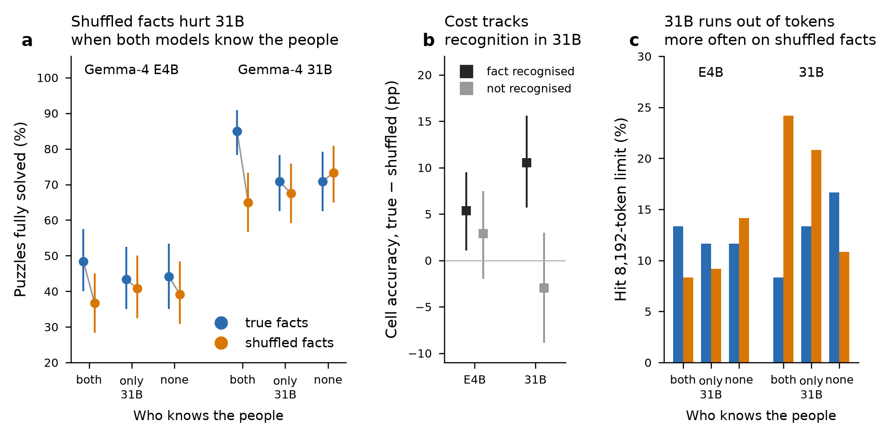

# Knowledge conflict in ZebraLogic, v3: Gemma-4 E4B vs 31B

## Question
When a ZebraLogic puzzle uses real people's attributes, does the model's own world knowledge interfere with closed-world deduction, and does this depend on model size? Each puzzle is solved twice: once where the gold solution matches the real facts (**true facts**), and once where every attribute is reassigned to a different person (**shuffled facts**). Clues, headers and logic are identical.

## Design
- **Candidates:** 4,515 Wikidata people, stratified by fame ([candidates_v3.csv](../../data/persons/candidates_v3.csv)). Attributes are birthplace, occupation and birth year.
- **Knowledge probe:** 4-option MCQA with one recall sentence before the letter ("brief" mode), run for each model ([mcqa_knowledge_vs_fame.png](../../results/04_mcqa_probe_v3/mcqa_knowledge_vs_fame.png)).
- **Pools, strict rule** (knows = all 3 facts correct; doesn't know = 0 correct; [POOLS_V3_README.md](../pipeline/POOLS_V3_README.md)):
  - **both know:** 560 people;
  - **only 31B knows:** 48 people;
  - **neither knows:** 222 people.
- **Puzzles:** the same 120 ZebraLogic templates are used in every pool (40 each of 4×4, 5×4, 6×4). That gives 3 pools × 120 × 2 conditions = 720 puzzles per model ([zebralogic_pools_v3.parquet](../../data/puzzles/zebralogic_pools_v3.parquet), [VARIANTS_V3_README.md](../pipeline/VARIANTS_V3_README.md)). True-fact variants are 100% true; shuffled variants are 0% true.
- **Inference:** greedy decoding, max 8,192 output tokens, nodo08 vLLM endpoint. A truncated answer counts as wrong. All 720/720 puzzles were completed for each model ([E4B outputs](../../data/README.md#excluded-raw-model-outputs), [31B outputs](../../data/README.md#excluded-raw-model-outputs)).
- **Recognition flag:** an in-puzzle MCQA, whose options are the puzzle's own values, marks each fact as *recognised* or not by each model ([inpuzzle_mcqa_summary.csv](../../results/04_mcqa_probe_v3/inpuzzle_mcqa_summary.csv)).
- **Statistics** ([analyze_v3.py](../../src/analyze_v3.py)):
  - true vs shuffled within each pool: McNemar test, Holm-corrected within each model;
  - cell-level gaps: template-cluster bootstrap;
  - pool contrasts (diff-in-diff): bootstrap over templates.

## Results

*(a) Puzzle accuracy with 95% bootstrap CIs; n = 120 templates per point. (b) Cell-accuracy gap (true − shuffled), split by whether the model recognised the fact in the in-puzzle MCQA. (c) Share of answers that hit the 8,192-token limit.*

### 1. Puzzle accuracy ([v3_summary.csv](../../results/05_persons_v3/v3_summary.csv), [v3_tests.csv](../../results/05_persons_v3/v3_tests.csv))

| Model | Pool | True facts | Shuffled | Gap (pp) | Discordant pairs (true-only / shuffled-only) | Holm p | Cell gap pp [95% CI] |
|---|---|---|---|---|---|---|---|
| 31B | both know | 85.0% | 65.0% | **20.0** | 29 / 5 | <0.001 | **17.5 [10.3, 24.9]** |
| 31B | only 31B knows | 70.8% | 67.5% | 3.3 | 14 / 10 | 1.0 | 3.6 [−2.3, 9.6] |
| 31B | neither knows | 70.8% | 73.3% | −2.5 | 11 / 14 | 1.0 | −3.7 [−9.7, 2.0] |
| E4B | both know | 48.3% | 36.7% | 11.7 | 23 / 9 | 0.060 | 4.0 [−1.4, 9.5] |
| E4B | only 31B knows | 43.3% | 40.8% | 2.5 | 12 / 9 | 0.86 | −0.8 [−6.5, 4.8] |
| E4B | neither knows | 44.2% | 39.2% | 5.0 | 23 / 17 | 0.86 | 3.6 [−3.8, 11.0] |

The effect grows with puzzle size. On 6×4 puzzles in "both know", 31B falls from 72% to 25% (n = 40).

### 2. Is the cost specific to knowledge? ([v3_diff_in_diff.csv](../../results/05_persons_v3/v3_diff_in_diff.csv), [v3_knowledge_gap.csv](../../results/05_persons_v3/v3_knowledge_gap.csv), [v3_knowledge_gap_by_pool.csv](../../results/05_persons_v3/v3_knowledge_gap_by_pool.csv))

**Diff-in-diff:** the gap in a pool minus the gap in "neither knows", over the same templates.

| Model | Contrast | Diff-in-diff (pp) [95% CI] | p |
|---|---|---|---|
| 31B | both − none | **22.5 [10.8, 35.0]** | <0.001 |
| 31B | only 31B − none | 5.8 [−5.8, 17.5] | 0.35 |
| E4B | both − none | 6.7 [−6.7, 20.0] | 0.36 |
| E4B | only 31B − none | −2.5 [−15.0, 10.0] | 0.75 |

**Cells split by recognition, all pools pooled:**
- **31B:** gap 10.5 pp [5.7, 15.6] on recognised facts vs −3.0 pp [−8.9, 3.0] on unrecognised ones. Difference 13.5 pp [7.1, 19.8], bootstrap p = 0.000.
- **E4B:** 5.3 pp [1.1, 9.5] vs 2.9 pp [−2.0, 7.5]. Difference 2.4 pp [−2.0, 6.6], p = 0.27.

**Within pools:** 31B's gap on recognised cells is 21.3 pp [12.6, 30.0] in "both know", but only 4.9 pp [−1.9, 12.2] in "only 31B knows".

### 3. Facilitation vs interference ([v3_facilitation_interference.csv](../../results/05_persons_v3/v3_facilitation_interference.csv))
Each condition in a knowledge pool is compared with the same condition in "neither knows", template by template:

| Model | Pool | True facts vs none (facilitation) | Shuffled vs none (interference) |
|---|---|---|---|
| 31B | both know | **+14.2 pp [5.0, 23.3], p = 0.002** | **−8.3 pp [−16.7, −0.8], p = 0.046** |
| 31B | only 31B knows | 0.0 [−8.3, 8.3] | −5.8 [−12.5, 0.8], p = 0.11 |
| E4B | both know | +4.2 [−5.8, 14.2] | −2.5 [−11.7, 6.7] |
| E4B | only 31B knows | −0.8 [−11.7, 10.0] | +1.7 [−9.2, 11.7] |

### 4. Truncation and search length ([v3_sensitivity_no_truncation.csv](../../results/05_persons_v3/v3_sensitivity_no_truncation.csv))
- **31B searches longer on shuffled facts about known people.**
  - Median completion tokens: "both know" 1,283 → 2,129 and "only 31B knows" 1,483 → 2,122, against 1,530 → 1,549 for "neither knows".
  - Share hitting the 8,192-token limit: 8.3% → 24.2% ("both know") and 13.3% → 20.8% ("only 31B knows"), against 16.7% → 10.8% ("neither knows").
- **E4B uses about 5,400–5,900 tokens in every cell**, with no condition-specific change in truncation.
- **The truncated outputs are genuine search.** They show long trial-and-error enumeration, not degenerate repetition.
- **Sensitivity check:** dropping every template truncated in either condition (a conservative check, because it selects on outcome) leaves:
  - 31B "both know": 93.3% → 85.4% (−7.9 pp, n = 89, p = 0.092);
  - E4B "both know": 56.9% → 42.2% (−14.7 pp, n = 102, p = 0.011);
  - all other pools non-significant.

## Conclusions
1. **The larger model is the one hurt by knowledge conflict, and the cost tracks its knowledge.** 31B loses 20 pp when facts about well-known people are shuffled; it shows no loss on unknown people. The diff-in-diff (22.5 pp) and the recognition-conditioned gap (13.5 pp) are both clearly non-zero.
2. **Part of 31B's advantage on true facts is borrowed knowledge.** 31B solves true-fact puzzles about famous people 14 pp better than the same templates with unknown people (6×4: 72% vs 38%). Shuffling removes that bonus and adds a further penalty, so the true–shuffled gap combines facilitation and interference.
3. **The mechanism shows up as longer search.** Conflicting facts make 31B explore longer and run out of budget three times as often. About half the puzzle-level gap goes through truncation.
4. **The SLM is mostly insensitive.** E4B shows a raw 11.7 pp drop in "both know", but it is not significantly larger than its drop on unknown people (diff-in-diff 6.7 pp, p = 0.36). Its recognition-conditioned gap is not significant either. This matches the earlier 39-person study ([persons_two_models_report.md](persons_two_models_report.md)), with more power and a clearer mechanism.
5. **Recognition is not enough.** In "only 31B knows" (mid-fame people, median 20 sitelinks), 31B recognises about 84% of the facts but shows no clear conflict cost. Interference appears to need strongly held knowledge, as for the top-fame "both know" pool (median 112.5 sitelinks), not just quiz-level recognition.

## Limitations
- **Fame and value confound across pools.** The pools differ in fame and in their value vocabularies (cities, occupations, years). Within-pool true-vs-shuffled comparisons are clean. The cross-pool facilitation estimate could partly reflect familiar values being easier to track, not knowledge shortcuts.
- **The "only 31B knows" pool is small:** 48 people, one reused up to 31 times, and a single draw (d0).
- **One model family, one draw, greedy decoding.**
- **The 8,192-token cap shapes the 6×4 results.**
- **The recognition flag is imperfect.** It comes from in-puzzle MCQA, and birthplace is partly guessable from names (none pool: 31B 67%, E4B 55%).

## Next steps
1. **Mine the reasoning traces.** Check whether 31B explicitly invokes real facts (e.g., "but X was actually born in…") or second-guesses clues in shuffled puzzles. This is cheap and would directly support the interference mechanism.
2. **Add model families** (Qwen3.5-9B / Qwen3.8-27B, Llama-3.1-8B, Salamandra-7B), each with its own probe and pools.
3. **Add more draws for "only 31B knows"**, plus a fame-matched comparison, to separate knowledge strength from recognition.
4. **Raise the token budget** (16k) on 6×4, or treat "ran out of budget" as an explicit secondary outcome.
5. **Test mitigations,** in line with the thesis: a closed-world instruction, a constraint-solver tool, or training that rewards clue-only justification. Then check whether they remove 31B's penalty without removing its facilitation.
